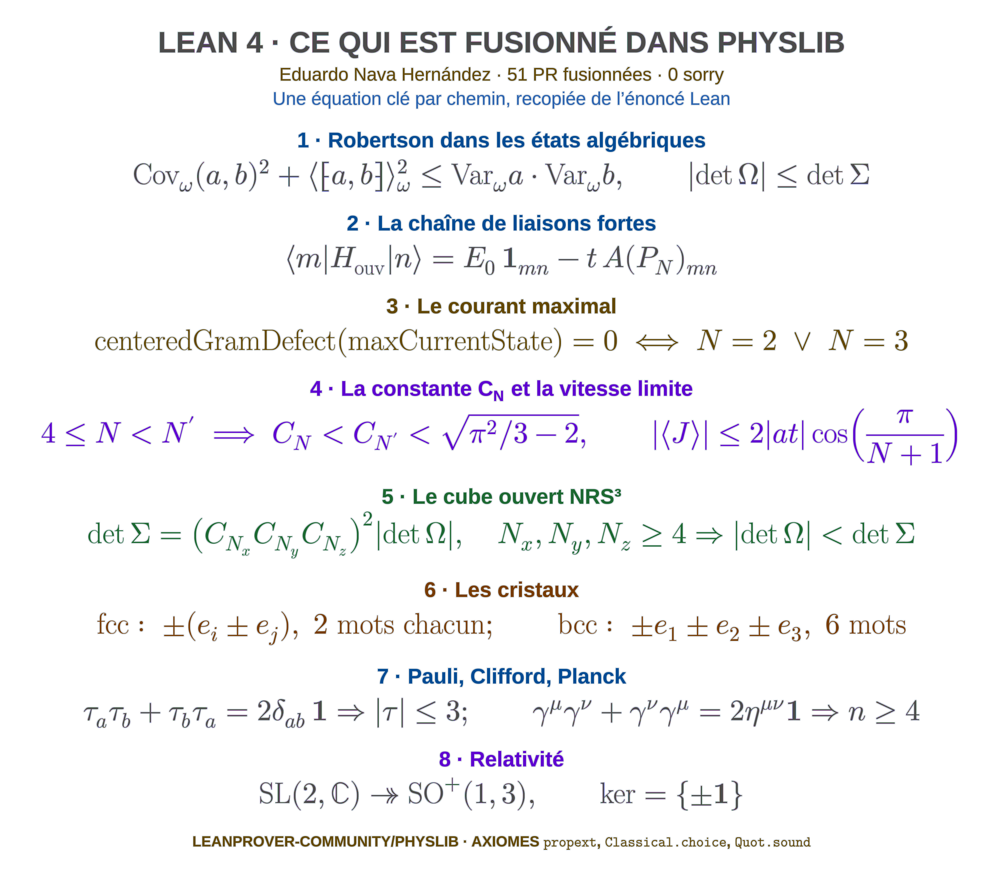
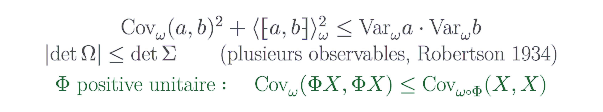
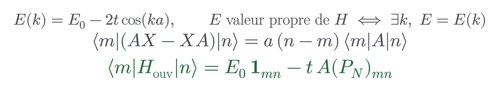
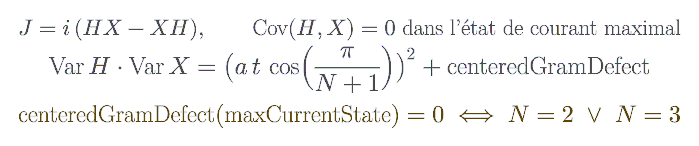
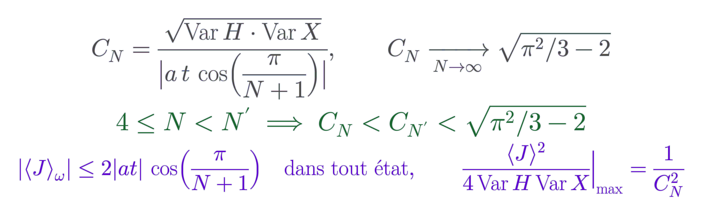
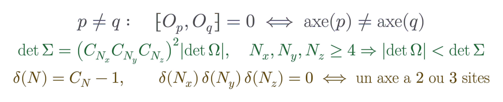
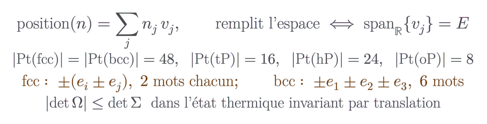
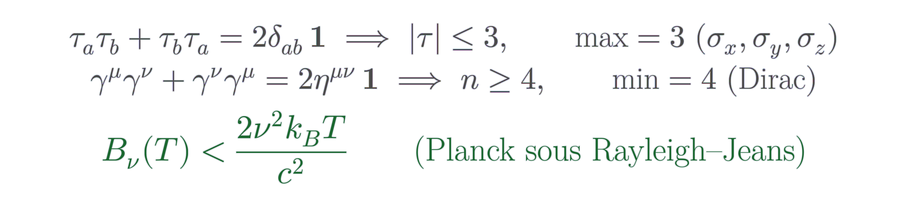
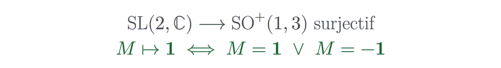

# 1 · Lean 4 · Les commits
### Tout ce qu’Eduardo Nava Hernández a écrit en Lean 4 : huit chemins fusionnés dans Physlib et les dépôts compilés du profil

**Eduardo Nava Hernández**  
*Vérification formelle en Lean 4 · 0 sorry · Physlib (PhyslibAlpha)*

---

> ### 🏛️ Le module maître : une équation clé par chemin
>
> Cinquante et une pull requests fusionnées dans [Physlib](https://github.com/leanprover-community/physlib), la bibliothèque de physique de la communauté Lean, forment huit chemins. Chacun mène à un théorème clé ; l’équation ci-dessous est recopiée de son énoncé Lean.
>
> 

> <picture><source media="(prefers-color-scheme: dark)" srcset="assets/oscuro/plaque_lc_maitresse.png"></picture>
> 

>
> **1 · Robertson** dans tout état d’une algèbre. **2 · La chaîne** de liaisons fortes est le saut du graphe chemin de Mathlib. **3 · Le courant maximal** sature Robertson–Schrödinger exactement en N = 2, 3. **4 · La constante C_N** croît strictement sous √(π²/3 − 2). **5 · Le cube ouvert NRS³** porte det Σ = (C_Nx C_Ny C_Nz)² |det Ω|. **6 · Les cristaux** : réseaux de Bravais, groupes ponctuels, fcc et bcc comme mots de pas d’axe. **7 · Pauli, Clifford, Planck.** **8 · SL(2, ℂ)** recouvre le groupe de Lorentz restreint.

---

## 📐 Les huit chemins

La liste complète des pull requests, chemin par chemin, est dans [merged/](merged/README.md). Ici, seulement les pas qui mènent à chaque théorème clé.

### Chemin 1 : Robertson dans les états algébriques

> **Théorème clé.** Dans tout état ω d’une algèbre, Cov(a, b)² + ⟨⁅a, b⁆⟩² ≤ Var a · Var b, et pour plusieurs observables |det Ω| ≤ det Σ (Robertson 1934). Une application positive unitaire Φ ne diminue pas la covariance : Cov_ω(ΦX, ΦX) ≤ Cov_{ω∘Φ}(X, X).

<picture><source media="(prefers-color-scheme: dark)" srcset="assets/oscuro/plaque_lc_robertson.png"></picture>

*Pas :* cas d’égalité et bornes normalisées (#1649, #1650) → états vecteurs et états densité (#1660, #1676) → déterminant de Robertson et son cas d’égalité (#1730, #1774) → forme de covariance et lemme de Schur (#1822) → applications unitaires (#1844).  
*Lean :* `robertson_schrodinger`, `robertson_det`, `covarianceForm_map_le_of_positive`.

### Chemin 2 : La chaîne de liaisons fortes

> **Théorème clé.** Les énergies E(k) = E₀ − 2t cos(ka) sont exactement les valeurs propres de la chaîne ; la chaîne ouverte est E₀ fois l’identité moins t fois la matrice d’adjacence du graphe chemin de Mathlib.

<picture><source media="(prefers-color-scheme: dark)" srcset="assets/oscuro/plaque_lc_chaine.png"></picture>

*Pas :* bords ouverts et position (#1689) → relation énergie–position (#1690, #1709) → les énergies sont tout le spectre (#1901) → la chaîne ouverte est le saut de `pathGraph` (#2096) → la chaîne est un cristal périodique fini (#2118).  
*Lean :* `hasEigenvalue_hamiltonian_iff`, `inner_commutator_position`, `inner_openHamiltonian_eq_adjMatrix`.

### Chemin 3 : Le courant maximal et la saturation

> **Théorème clé.** Dans l’état de courant maximal, Cov(H, X) = 0 et Var H · Var X = (a t cos(π/(N+1)))² + défaut ; le défaut est nul si et seulement si N = 2 ou N = 3.

<picture><source media="(prefers-color-scheme: dark)" srcset="assets/oscuro/plaque_lc_courant.png"></picture>

*Pas :* le courant J = i(HX − XH) et ses états propres (#1696, #1708) → l’état de courant maximal (#1716) → saturation (#1718) → incertitude élémentaire et variances (#1723, #1732) → commutateurs du courant et électron localisé (#1775, #1778).  
*Lean :* `covariance_maxCurrentState`, `variance_mul_variance_maxCurrentState`, `centeredGramDefect_maxCurrentState_eq_zero_iff`.

### Chemin 4 : La constante C_N, Szegő et la vitesse limite

> **Théorème clé.** C_N est strictement croissante dès N = 4, reste sous √(π²/3 − 2) et y tend ; dans tout état |⟨J⟩| ≤ 2|at| cos(π/(N+1)), et le rapport de Mandelstam–Tamm vaut 1/C_N² dans l’état de courant maximal.

<picture><source media="(prefers-color-scheme: dark)" srcset="assets/oscuro/plaque_lc_cn.png"></picture>

*Pas :* limite et monotonie (#1734, #1735) → Mandelstam–Tamm et Cramér–Rao (#1711, #1739) → vitesse limite (#1724) → bande de vitesse et sa largeur (#1745, #1746).  
*Lean :* `uncertaintyRatio_lt_uncertaintyRatio`, `uncertaintyRatio_lt_sqrt_pi_sq_div_three_sub_two`, `tendsto_uncertaintyRatio`, `abs_expectation_current_le`, `mandelstamTammRatio_maxCurrentState`.

### Chemin 5 : Le cube ouvert NRS³

> **Théorème clé.** Deux observables distinctes du cube commutent si et seulement si elles sont sur des axes différents ; dans l’état de courant maximal, det Σ = (C_Nx C_Ny C_Nz)² |det Ω|, strict dès 4 × 4 × 4 ; le quantum volumétrique δ(Nx) δ(Ny) δ(Nz), avec δ = C_N − 1, est nul si et seulement si un axe a 2 ou 3 sites.

<picture><source media="(prefers-color-scheme: dark)" srcset="assets/oscuro/plaque_lc_cube.png"></picture>

*Pas :* opérateurs sur une coordonnée et états produits (#1695, #1699, #1717) → le cube NRS³ (#1725) → déterminant du cube (#1742) → angle NRS et quantum volumétrique (#1756) → commutation si et seulement si axes différents (#1986).  
*Lean :* `bracket_cubePairs_eq_zero_iff`, `det_covarianceMatrix_maxCurrentCubeState`, `robertson_det_maxCurrentCubeState_strict`, `volQuantum_eq_zero_iff`.

### Chemin 6 : Les cristaux

> **Théorème clé.** Un site d’un réseau de Bravais est en n₁v₁ + … + n_dv_d, et le réseau remplit l’espace si et seulement si les vecteurs l’engendrent ; les voisins de fcc sont les sommes ±(eᵢ ± eⱼ) de deux pas d’axe, atteintes chacune par 2 mots, et ceux de bcc les sommes ±e₁ ± e₂ ± e₃, atteintes par 6 mots.

<picture><source media="(prefers-color-scheme: dark)" srcset="assets/oscuro/plaque_lc_cristaux.png"></picture>

*Pas :* réseaux de Bravais et leur plongement (#1961) → groupes ponctuels : tétragonal, hexagonal, orthorhombique, rhomboédrique, monoclinique, triclinique, plusieurs sites par maille (#1798, #1802, #1823, #1825, #1826, #1896) → Robertson dans l’état thermique invariant par translation (#1803) → fcc et bcc comme mots de pas d’axe (#1987).  
*Lean :* `position_ofVectors`, `isSpaceFilling_ofVectors_iff`, `fcc_card_pointGroup`, `fccBonds_eq_twoStepWords`, `card_twoStepWords_fiber`, `card_threeStepWords_fiber`, `robertson_det_translationInvariantState`.

### Chemin 7 : Pauli, Clifford et Planck

> **Théorème clé.** Une famille de matrices 2 × 2 qui anticommutent a au plus trois membres, et les matrices de Pauli l’atteignent ; une famille de Clifford pour η demande des matrices de taille au moins 4 × 4, atteinte par les matrices de Dirac ; la loi de Planck est strictement sous Rayleigh–Jeans.

<picture><source media="(prefers-color-scheme: dark)" srcset="assets/oscuro/plaque_lc_pauli.png"></picture>

*Pas :* matrices de Pauli maximales (#1762) → les matrices gamma demandent quatre dimensions (#1768) → Planck sous Rayleigh–Jeans (#1761).  
*Lean :* `card_le_three`, `isGreatest_card_isAnticommuting`, `isLeast_size_isCliffordFamily`, `spectralRadiance_lt_rayleighJeans`.

### Chemin 8 : SL(2, ℂ) et le groupe de Lorentz

> **Théorème clé.** L’homomorphisme de SL(2, ℂ) vers le groupe de Lorentz restreint est surjectif, de noyau {1, −1}.

<picture><source media="(prefers-color-scheme: dark)" srcset="assets/oscuro/plaque_lc_sl2c.png"></picture>

*Pas :* bases de la couverture (#1886) → rotations de Cayley–Klein (#1887) → la double couverture (#1885).  
*Lean :* `toLorentzGroup_eq_one_iff`, `toRestrictedLorentzGroup_surjective`.

---

## 🧮 Les algèbres

La couche algébrique sur laquelle reposent les chemins (`PhyslibAlpha/ProbabilisticTheory`, le cadre de Tom Ole Diem ; le fichier `CStarAlgebra/Uncertainty.lean` porte les deux noms) :

| Algèbre | Ce qui est démontré |
|---|---|
| États d’une C\*-algèbre | Robertson–Schrödinger et son cas d’égalité ; Robertson 1934 \|det Ω\| ≤ det Σ |
| Espace de Hilbert, états densité | variance et défaut de Gram des états vecteurs ; forme de covariance, invariance, lemme de Schur |
| Applications unitaires (Schwarz) | les variances et covariances ne diminuent pas |
| Algèbre de Pauli | au plus trois involutions 2 × 2 qui anticommutent |
| Algèbre de Clifford | une famille de Clifford a une taille paire, au moins 4 × 4 |
| sl(2, ℂ) | la double couverture du groupe de Lorentz restreint |
| Observables du cube | une paire par axe ; des axes différents commutent |

**En attente de revue** : [PR 2102](https://github.com/leanprover-community/physlib/pull/2102) (le hamiltonien du cube ouvert est l’adjacence du graphe chemin sur chaque axe) et [PR 2122](https://github.com/leanprover-community/physlib/pull/2122) (le seuil de la chaîne à quatre sites est au moins 3/2 |a t|).

---

## 🗂️ Les dépôts compilés

Chaque dépôt compile seul, en Lean 4 sur Mathlib, certains sur Physlib, avec les seuls axiomes standards. La liste, une ligne par dépôt, est dans [compiled/](compiled/README.md).

Les dépôts du profil ont leur propre licence ; les contributions à Physlib suivent la licence Apache 2.0 de Physlib.

### 📐 *« Un lemme qui relie Mathlib pur au cadre de Physlib : huit chemins, une équation clé chacun. »*

**Eduardo Nava Hernández** · [naype888-cloud](https://github.com/naype888-cloud)

